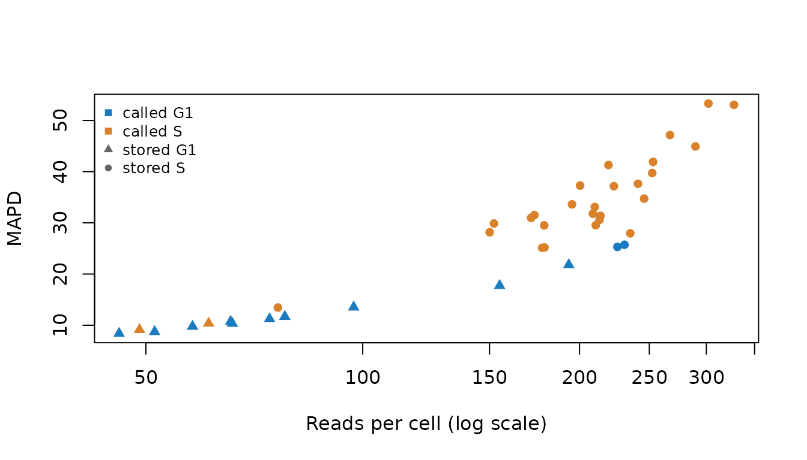
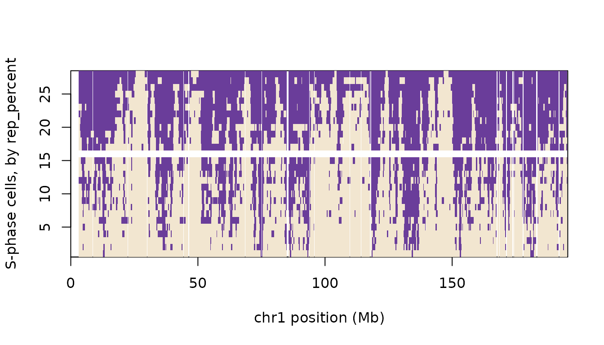
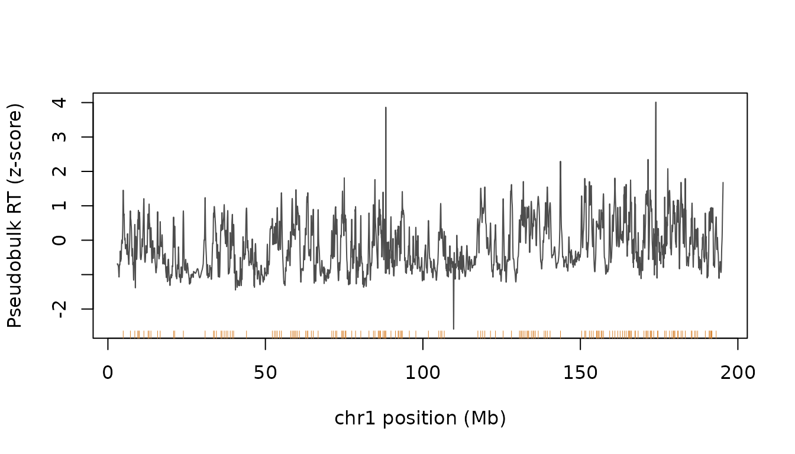
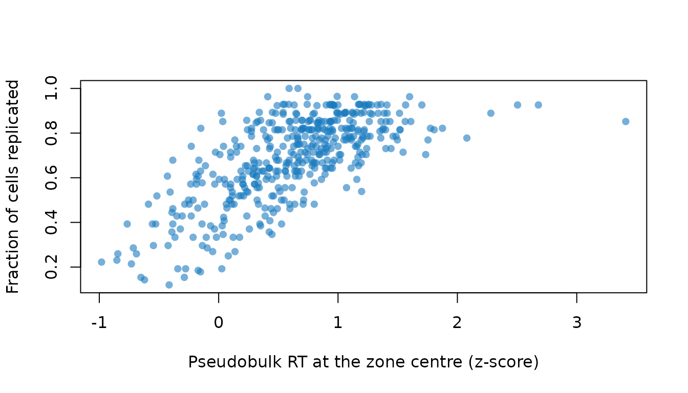
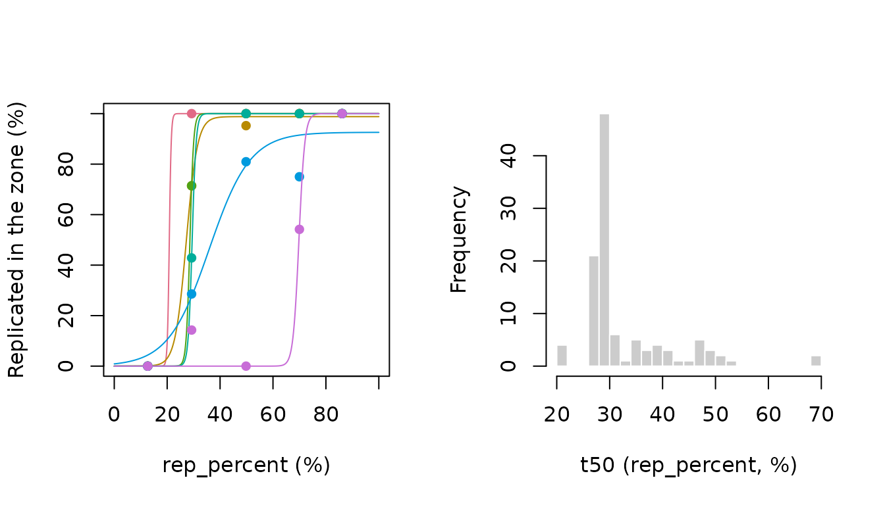
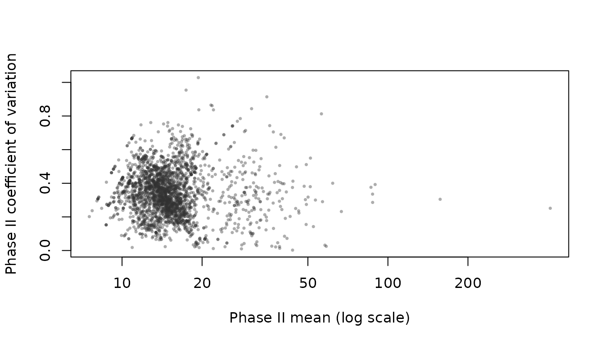
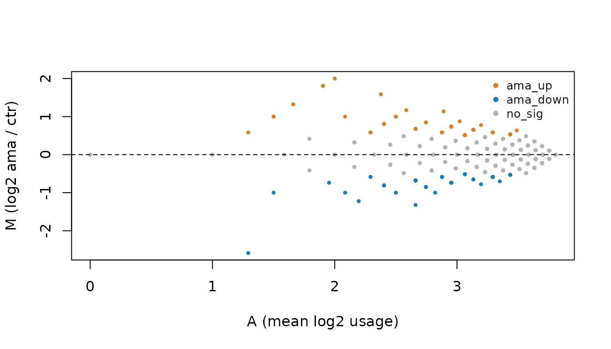

# scRTtools: an end-to-end walk-through

This vignette runs the whole analysis chain of the package on the small
example dataset that ships with it, and shows the object each step
returns. The package itself has no plotting functions; the figures are
drawn with base R graphics so that you can see what each result looks
like.

| Section | Main functions |
|----|----|
| 1 | [`make_fixed_bins()`](https://midimagi.github.io/scRTtools/reference/make_fixed_bins.md), [`count_reads()`](https://midimagi.github.io/scRTtools/reference/count_reads.md), [`calculate_mapd()`](https://midimagi.github.io/scRTtools/reference/calculate_mapd.md), [`find_g1_cells()`](https://midimagi.github.io/scRTtools/reference/find_g1_cells.md), [`define_G1_windows()`](https://midimagi.github.io/scRTtools/reference/define_G1_windows.md) |
| 2 | [`assign_replication_states()`](https://midimagi.github.io/scRTtools/reference/assign_replication_states.md), [`compute_rep_percent()`](https://midimagi.github.io/scRTtools/reference/compute_rep_percent.md) |
| 3 | [`define_replication_tracks()`](https://midimagi.github.io/scRTtools/reference/define_replication_tracks.md), [`calc_rep_track_lengths()`](https://midimagi.github.io/scRTtools/reference/calc_rep_track_lengths.md), [`calc_rep_track_gaps()`](https://midimagi.github.io/scRTtools/reference/calc_rep_track_gaps.md) |
| 4 | [`calculate_pseudobulk_rt()`](https://midimagi.github.io/scRTtools/reference/calculate_pseudobulk_rt.md), [`find_rt_peaks()`](https://midimagi.github.io/scRTtools/reference/find_rt_peaks.md), [`count_track_centers()`](https://midimagi.github.io/scRTtools/reference/count_track_centers.md) |
| 5 | [`define_initiation_zones()`](https://midimagi.github.io/scRTtools/reference/define_initiation_zones.md), [`calculate_firing_range()`](https://midimagi.github.io/scRTtools/reference/calculate_firing_range.md), [`calculate_firing_order()`](https://midimagi.github.io/scRTtools/reference/calculate_firing_order.md) |
| 6 | [`rep_tempo()`](https://midimagi.github.io/scRTtools/reference/rep_tempo.md), [`fit_rep_tempo()`](https://midimagi.github.io/scRTtools/reference/fit_rep_tempo.md) |
| 7 | [`SC2P_gene_unit()`](https://midimagi.github.io/scRTtools/reference/SC2P_gene_unit.md), [`gex_tempo()`](https://midimagi.github.io/scRTtools/reference/gex_tempo.md), [`analyze_one_group()`](https://midimagi.github.io/scRTtools/reference/analyze_one_group.md) |
| 8 | [`pivot_state_wide()`](https://midimagi.github.io/scRTtools/reference/pivot_state_wide.md), [`add_ma_columns()`](https://midimagi.github.io/scRTtools/reference/add_ma_columns.md), [`call_diff_groups()`](https://midimagi.github.io/scRTtools/reference/call_diff_groups.md) |
| 9 | [`full_rank_model_matrix()`](https://midimagi.github.io/scRTtools/reference/full_rank_model_matrix.md), [`fit_ols_hc3()`](https://midimagi.github.io/scRTtools/reference/fit_ols_hc3.md), [`fit_poisson_hc3()`](https://midimagi.github.io/scRTtools/reference/fit_poisson_hc3.md), [`combine_two_samples()`](https://midimagi.github.io/scRTtools/reference/combine_two_samples.md) |
| 10 | Seurat / Harmony / BPCells (not run), [`add_sample_prefix()`](https://midimagi.github.io/scRTtools/reference/sample_files.md), [`find_sample_file()`](https://midimagi.github.io/scRTtools/reference/sample_files.md) |

The example holds 40 cells of one sample, so the numbers below show what
the objects look like. They carry no biological conclusion.

``` r

library(scRTtools)
library(GenomicRanges)
col_g1 <- "#1b7bbf"; col_s <- "#d9822b"; col_rep <- "#6a3d9a"; col_unrep <- "#f2e6d0"
```

## The example data

[`scrt_example_data()`](https://midimagi.github.io/scRTtools/reference/scrt_example_data.md)
returns the autosomes (chr1 to chr19) of 12 G1 and 28 S-phase cells of
one mouse ESC 10x multiome sample (mm10, 20 kb bins).

``` r

ex <- scrt_example_data()
names(ex)
#> [1] "bins"          "bin_counts"    "g1_windows"    "window_counts" "rep_states"    "rna_counts"   
#> [7] "genes"         "meta"          "info"
str(ex$info)
#> List of 5
#>  $ sample     : chr "scRT1"
#>  $ chromosomes: chr [1:19] "chr1" "chr2" "chr3" "chr4" ...
#>  $ genome     : chr "mm10"
#>  $ bin_width  : int 20000
#>  $ created    : chr "2026-11-12"
ex$bins[1:3]
#> GRanges object with 3 ranges and 3 metadata columns:
#>                    seqnames      ranges strand | gc_frequency mappability is_mappable
#>                       <Rle>   <IRanges>  <Rle> |    <numeric>   <numeric>   <logical>
#>       chr1-1-20000     chr1     1-20000      * |            0           0       FALSE
#>   chr1-20001-40000     chr1 20001-40000      * |            0           0       FALSE
#>   chr1-40001-60000     chr1 40001-60000      * |            0           0       FALSE
#>   -------
#>   seqinfo: 19 sequences from mm10 genome
dim(ex$bin_counts)
#> [1] 123148     40
head(ex$meta[, c("sample", "is_G1", "rep_percent", "coverage", "mapd")], 4)
#>                          sample is_G1 rep_percent coverage  mapd
#> scRT1-GGTTGCGGTGAGCAAG-1  scRT1  TRUE     0.05176    45.89 8.383
#> scRT1-ACCTAAATCGCATCCT-1  scRT1  TRUE     0.17117    48.98 9.152
#> scRT1-AACTACTCATTTGCTC-1  scRT1  TRUE     0.93434    51.33 8.755
#> scRT1-GAACCTTAGTCACCTC-1  scRT1  TRUE     0.14696    58.02 9.833
```

## 1. Bins, counts and G1 cells

The first steps read a genome, a mappability track and the fragment file
of each sample, which the example does not ship. Their results are
stored in `ex$bins`, `ex$bin_counts`, `ex$g1_windows` and
`ex$window_counts`. On real data the calls look like this:

``` r

bins <- make_fixed_bins(seqinfo, bin_width = 20000)                 # 1.1
bins <- compute_bin_mappability(bins, mappability_bedgraph)         # 1.1
g1_windows <- define_G1_windows(bins, "atac_fragments.tsv.gz",      # 1.2
                                meta_data, target_reads = 200)
```

MAPD (the median absolute pairwise difference of neighbouring bins)
measures how uneven the coverage of a cell is.
[`find_g1_cells()`](https://midimagi.github.io/scRTtools/reference/find_g1_cells.md)
fits the relation between MAPD and coverage and calls the cells on the
low-MAPD branch G1.

``` r

bin_counts <- Matrix::Matrix(ex$bin_counts, sparse = TRUE)
mapd <- calculate_mapd(bin_counts, ex$bins, ex$meta[, c("cell_id", "sample")],
                       verbose = FALSE)
g1 <- find_g1_cells(mapd, seed = 1, verbose = FALSE)
head(g1[, c("sample", "coverage", "mapd", "scaled_mapd", "is_G1")], 4)
#>                          sample coverage  mapd scaled_mapd is_G1
#> scRT1-GGTTGCGGTGAGCAAG-1  scRT1    45.90 8.386       1.238  TRUE
#> scRT1-ACCTAAATCGCATCCT-1  scRT1    48.99 9.132       1.305 FALSE
#> scRT1-AACTACTCATTTGCTC-1  scRT1    51.41 8.729       1.217  TRUE
#> scRT1-GAACCTTAGTCACCTC-1  scRT1    58.04 9.768       1.282  TRUE
table(recomputed = g1$is_G1, stored = ex$meta[g1$cell_id, "is_G1"])
#>           stored
#> recomputed FALSE TRUE
#>      FALSE    26    2
#>      TRUE      2   10
```

The stored `is_G1` was called among all cells of the sample. Among these
40 cells the call agrees for 36: it recovers 10 of the 12 G1 cells and
calls 2 S-phase cells G1. The rest of the vignette uses the stored
labels.

In the plot, colour is the call made here and shape is the stored label.

``` r

plot(g1$coverage, g1$mapd, log = "x", col = ifelse(g1$is_G1, col_g1, col_s),
     pch = ifelse(ex$meta[g1$cell_id, "is_G1"], 17, 16),
     xlab = "Reads per cell (log scale)", ylab = "MAPD")
legend("topleft", c("called G1", "called S", "stored G1", "stored S"),
       col = c(col_g1, col_s, "grey40", "grey40"), pch = c(15, 15, 17, 16),
       bty = "n", cex = 0.8)
```



## 2. Replication states

[`assign_replication_states()`](https://midimagi.github.io/scRTtools/reference/assign_replication_states.md)
runs a two-state HMM in every S-phase cell on the G1 windows and maps
the result back to the 20 kb bins (2 = unreplicated, 4 = replicated,
`NA` = no call). The `infer_args` are the package defaults.

``` r

s_cells <- rownames(ex$meta)[!ex$meta$is_G1]
window_counts <- Matrix::Matrix(ex$window_counts[, s_cells], sparse = TRUE)
res_states <- assign_replication_states(
  window_counts, ex$g1_windows, ex$bins,
  infer_args = list(hmm_aggr_width = 15L, init_ratio_lower = 1.2,
                    final_ratio_lower = 1.4),
  verbose = FALSE)
sapply(res_states, dim)
#>      genobins_rep_states g1bins_rep_states
#> [1,]              123148            101297
#> [2,]                  28                28
table(res_states$genobins_rep_states, useNA = "ifany")
#> 
#>       2       4    <NA> 
#> 1416654 1440520  590970
```

[`compute_rep_percent()`](https://midimagi.github.io/scRTtools/reference/compute_rep_percent.md)
gives every cell its replicated fraction, which is its position in S
phase, and drops cells that fail the quality filters.

``` r

res_rp <- compute_rep_percent(res_states$genobins_rep_states, ex$bins,
                              ex$meta[s_cells, c("cell_id", "sample")],
                              verbose = FALSE)
md <- res_rp$meta_data
head(md[order(md$rep_percent), c("sample", "rep_percent", "sigma_chr", "pass_qc")], 4)
#>                          sample rep_percent sigma_chr pass_qc
#> scRT1-CCTAATAAGTTATGTG-1  scRT1     0.06384   0.06549    TRUE
#> scRT1-GGAACTAAGGCTGTCA-1  scRT1     0.14256   0.10954    TRUE
#> scRT1-AATCCATCAGTAGGTG-1  scRT1     0.17321   0.15175    TRUE
#> scRT1-GCTATTGCAGGAACCA-1  scRT1     0.20572   0.21655    TRUE

states <- res_rp$genobins_rep_states_filtered
keep <- intersect(colnames(states), rownames(md)[is.finite(md$rep_percent)])
states <- states[, keep, drop = FALSE]
md <- md[keep, , drop = FALSE]
dim(states)
#> [1] 123148     28
```

All 28 S-phase cells pass the filters, and `rep_percent` computed here
is identical to the value of the original analysis stored in `ex$meta`:

``` r

cor(md$rep_percent, ex$meta[keep, "rep_percent"])
#> [1] 1
max(abs(md$rep_percent - ex$meta[keep, "rep_percent"]))
#> [1] 0
```

With the cells sorted by `rep_percent`, the states on chr1 show S phase
going from early to late: the replicated (purple) regions widen from the
bottom row to the top. White means no call.

``` r

on_chr1 <- which(as.character(seqnames(ex$bins)) == "chr1")
cell_order <- order(md$rep_percent)
replicated <- states[on_chr1, cell_order, drop = FALSE] == 4
image(x = start(ex$bins)[on_chr1] / 1e6, y = seq_along(cell_order),
      z = replicated + 0, col = c(col_unrep, col_rep), useRaster = TRUE,
      xlab = "chr1 position (Mb)", ylab = "S-phase cells, by rep_percent")
```



To choose the HMM thresholds on new data,
[`evaluate_state_parameters()`](https://midimagi.github.io/scRTtools/reference/evaluate_state_parameters.md)
runs a grid of settings on a subset of cells and
[`rank_state_parameters()`](https://midimagi.github.io/scRTtools/reference/rank_state_parameters.md)
orders them.

## 3. Replication tracks

A replication track is a run of replicated bins in one cell.

``` r

tracks <- define_replication_tracks(states, ex$bins,
                                    setNames(md$rep_percent, keep), verbose = FALSE)
tracks
#> GRangesList object of length 28:
#> $`scRT1-CCTAATAAGTTATGTG-1`
#> GRanges object with 163 ranges and 6 metadata columns:
#>         seqnames              ranges strand |                cell_id rep_percent        cn
#>            <Rle>           <IRanges>  <Rle> |            <character>   <numeric> <numeric>
#>     [1]     chr1   12680001-13340000      * | scRT1-CCTAATAAGTTATG..   0.0638432         4
#>     [2]     chr1   74680001-75480000      * | scRT1-CCTAATAAGTTATG..   0.0638432         4
#>     [3]     chr1   86200001-86720000      * | scRT1-CCTAATAAGTTATG..   0.0638432         4
#>     [4]     chr1   93160001-93460000      * | scRT1-CCTAATAAGTTATG..   0.0638432         4
#>     [5]     chr1 118280001-118720000      * | scRT1-CCTAATAAGTTATG..   0.0638432         4
#>     ...      ...                 ...    ... .                    ...         ...       ...
#>   [159]    chr18   77520001-78000000      * | scRT1-CCTAATAAGTTATG..   0.0638432         4
#>   [160]    chr19     4100001-6820000      * | scRT1-CCTAATAAGTTATG..   0.0638432         4
#>   [161]    chr19     6820001-7420000      * | scRT1-CCTAATAAGTTATG..   0.0638432         4
#>   [162]    chr19   38280001-38840000      * | scRT1-CCTAATAAGTTATG..   0.0638432         4
#>   [163]    chr19   47060001-47500000      * | scRT1-CCTAATAAGTTATG..   0.0638432         4
#>          num_bins      flag na_fraction
#>         <integer> <integer>   <numeric>
#>     [1]        33         0   0.0303030
#>     [2]        40         0   0.1250000
#>     [3]        26         0   0.0000000
#>     [4]        15         0   0.0000000
#>     [5]        22         0   0.0909091
#>     ...       ...       ...         ...
#>   [159]        24         0   0.1250000
#>   [160]       136         1   0.0514706
#>   [161]        30         1   0.0000000
#>   [162]        28         0   0.0000000
#>   [163]        22         0   0.0454545
#>   -------
#>   seqinfo: 19 sequences from an unspecified genome; no seqlengths
#> 
#> ...
#> <27 more elements>
track_lengths <- calc_rep_track_lengths(tracks)
head(track_lengths[, c("chr", "start", "end", "width_bp", "rep_percent", "flag")], 4)
#>    chr    start      end width_bp rep_percent flag
#> 1 chr1 12680001 13340000   660000     0.06384    0
#> 2 chr1 74680001 75480000   800000     0.06384    0
#> 3 chr1 86200001 86720000   520000     0.06384    0
#> 4 chr1 93160001 93460000   300000     0.06384    0
track_gaps <- calc_rep_track_gaps(tracks)
head(track_gaps[, c("rep_percent", "chr", "gap_bp")], 4)
#>   rep_percent  chr   gap_bp
#> 1     0.06384 chr1 61340000
#> 2     0.06384 chr1 10720000
#> 3     0.06384 chr1  6440000
#> 4     0.06384 chr1 24820000
head(summarize_track_lengths(track_lengths), 4)
#>                    cell_id median_length log_length rep_percent
#> 1 scRT1-AAACATGCACCCACCT-1       1280000      14.06       61.25
#> 2 scRT1-AATAGAGGTCCTCCAA-1       2400000      14.69       73.64
#> 3 scRT1-AATCCATCAGTAGGTG-1        710000      13.47       17.32
#> 4 scRT1-AGAACCAAGAAGGTGC-1        760000      13.54       34.94
```

Tracks get longer as cells progress through S phase, because
neighbouring tracks merge:

``` r

by_cell <- split(track_lengths$width_bp / 1e6, track_lengths$rep_percent)
boxplot(by_cell, at = 100 * as.numeric(names(by_cell)), boxwex = 2, log = "y",
        xaxt = "n", col = col_rep, outline = FALSE, xlim = c(0, 100),
        xlab = "rep_percent of the cell (%)", ylab = "Track length (Mb, log scale)")
axis(1)
```


With several samples or conditions,
[`fit_track_velocity_linear()`](https://midimagi.github.io/scRTtools/reference/fit_track_velocity_linear.md),
[`fit_track_length_models()`](https://midimagi.github.io/scRTtools/reference/fit_track_length_models.md)
and
[`fit_track_velocity_ode()`](https://midimagi.github.io/scRTtools/reference/fit_track_velocity_ode.md)
model track length against `rep_percent`. They need more cells than the
example holds.

## 4. Pseudobulk replication timing and peaks

[`calculate_pseudobulk_rt()`](https://midimagi.github.io/scRTtools/reference/calculate_pseudobulk_rt.md)
pools the S-phase cells and the G1 cells, corrects the S-phase counts
for GC content and mappability with the G1 pseudobulk, and returns a
smoothed z-score per bin (high = early replicating).
[`find_rt_peaks()`](https://midimagi.github.io/scRTtools/reference/find_rt_peaks.md)
finds its local maxima.

``` r

rt <- suppressWarnings(calculate_pseudobulk_rt(
  bin_counts, ex$bins, ex$meta[, c("cell_id", "sample", "is_G1", "pass_qc")]))
rt[1:3]
#> GRanges object with 3 ranges and 1 metadata column:
#>                        seqnames          ranges strand |     score
#>                           <Rle>       <IRanges>  <Rle> | <numeric>
#>   chr1-3000001-3020000     chr1 3000001-3020000      * | -0.685876
#>   chr1-3020001-3040000     chr1 3020001-3040000      * | -0.697085
#>   chr1-3040001-3060000     chr1 3040001-3060000      * | -0.703038
#>   -------
#>   seqinfo: 19 sequences from mm10 genome
summary(rt$score)
#>    Min. 1st Qu.  Median    Mean 3rd Qu.    Max. 
#> -3.2726 -0.6919 -0.1569 -0.0365  0.4389  4.9990
rt_peaks <- find_rt_peaks(rt)
length(rt_peaks)
#> [1] 2080
rt_peaks[1:3]
#> GRanges object with 3 ranges and 5 metadata columns:
#>                        seqnames          ranges strand |     score  RT_value local_median
#>                           <Rle>       <IRanges>  <Rle> | <numeric> <numeric>    <numeric>
#>   chr1-4860001-4880000     chr1 4860001-4880000      * |  1.452559  1.452559     1.225631
#>   chr1-7140001-7160000     chr1 7140001-7160000      * |  0.853131  0.853131     0.743256
#>   chr1-8540001-8560000     chr1 8540001-8560000      * |  0.456934  0.456934     0.209518
#>                        local_delta plateau_size
#>                          <numeric>    <integer>
#>   chr1-4860001-4880000    0.226927            1
#>   chr1-7140001-7160000    0.109875            1
#>   chr1-8540001-8560000    0.247416            1
#>   -------
#>   seqinfo: 19 sequences from mm10 genome
```

The pseudobulk profile of chr1, with the RT peaks marked below the axis:

``` r

rt_chr1 <- rt[seqnames(rt) == "chr1"]
plot(start(rt_chr1) / 1e6, rt_chr1$score, type = "l", col = "grey30",
     xlab = "chr1 position (Mb)", ylab = "Pseudobulk RT (z-score)")
rug(start(rt_peaks[seqnames(rt_peaks) == "chr1"]) / 1e6, col = col_s)
```



[`count_track_centers()`](https://midimagi.github.io/scRTtools/reference/count_track_centers.md)
counts, for a set of regions, the tracks whose centre falls in each of
them.

``` r

centers <- count_track_centers(tracks, rt_peaks)
table(centers$score)
#> 
#>    0    1    2    3    4    5   13   17 
#> 1699  318   47   11    2    1    1    1
centers[centers$score > 0][1:3]
#> GRanges object with 3 ranges and 5 metadata columns:
#>                          seqnames            ranges strand |     score  RT_value local_median
#>                             <Rle>         <IRanges>  <Rle> | <integer> <numeric>    <numeric>
#>   chr1-13660001-13680000     chr1 13660001-13680000      * |         1  0.364768     0.269725
#>   chr1-15780001-15800000     chr1 15780001-15800000      * |         2  0.826596     0.606107
#>   chr1-20860001-20880000     chr1 20860001-20880000      * |         1  0.670061     0.490123
#>                          local_delta plateau_size
#>                            <numeric>    <integer>
#>   chr1-13660001-13680000   0.0950428            1
#>   chr1-15780001-15800000   0.2204895            1
#>   chr1-20860001-20880000   0.1799381            1
#>   -------
#>   seqinfo: 19 sequences from mm10 genome
```

[`annotate_peak_scores()`](https://midimagi.github.io/scRTtools/reference/annotate_peak_scores.md)
adds the signal of bigWig or BED files to such regions. It needs
external files and is not run here.

## 5. Initiation zones

Short tracks cluster where replication starts.
[`define_initiation_zones()`](https://midimagi.github.io/scRTtools/reference/define_initiation_zones.md)
groups them around the RT peaks and returns the zones (IZ) and the
tracks with the zone each was assigned to. The default is
`min_usage = 3`; with 28 cells the vignette lowers it to 2.

``` r

res_iz <- define_initiation_zones(tracks, rt_peaks, min_usage = 2L, verbose = FALSE)
iz <- res_iz$izones
iz
#> GRanges object with 449 ranges and 7 metadata columns:
#>         seqnames            ranges strand |     iz_id        q5       q25       q50       q75
#>            <Rle>         <IRanges>  <Rle> | <integer> <numeric> <numeric> <numeric> <numeric>
#>     [1]     chr1   4898000-4977999      * |         1   4908000   4940000   4950000   4960000
#>     [2]     chr1   7083000-7147999      * |         2   7093000   7105000   7120000   7130000
#>     [3]     chr1 11370000-11409999      * |         3  11380000  11380000  11380000  11400000
#>     [4]     chr1 15790000-15836999      * |         4  15800000  15800000  15800000  15815000
#>     [5]     chr1 18090500-18119499      * |         5  18100500  18102500  18105000  18107500
#>     ...      ...               ...    ... .       ...       ...       ...       ...       ...
#>   [445]    chr19 41855000-41937999      * |       445  41865000  41885000  41910000  41920000
#>   [446]    chr19 55675000-55775999      * |       446  55685000  55705000  55730000  55750000
#>   [447]    chr19 56886000-56957999      * |       447  56896000  56920000  56930000  56940000
#>   [448]    chr19 58612000-58667999      * |       448  58622000  58630000  58640000  58650000
#>   [449]    chr19 59291000-59328999      * |       449  59301000  59305000  59310000  59315000
#>               q95  n_tracks
#>         <numeric> <integer>
#>     [1]   4968000         5
#>     [2]   7138000         3
#>     [3]  11400000         5
#>     [4]  15827000         3
#>     [5]  18109500         2
#>     ...       ...       ...
#>   [445]  41928000         3
#>   [446]  55766000         3
#>   [447]  56948000         5
#>   [448]  58658000         2
#>   [449]  59319000         2
#>   -------
#>   seqinfo: 19 sequences from an unspecified genome; no seqlengths
table(assigned = !is.na(unlist(res_iz$tracks)$iz_id))
#> assigned
#> FALSE  TRUE 
#> 11756  1654
```

The firing functions use an `rt` column on the zones. It is the fraction
of cells replicated at the zone centre. A zone whose centre bin has no
call in any cell gets `rt = NaN`.
[`calculate_firing_range()`](https://midimagi.github.io/scRTtools/reference/calculate_firing_range.md)
takes all zones, because the `iz_id` of the tracks indexes the full set;
the two order functions need a finite `rt` and get the other zones.

``` r

centre_bin <- findOverlaps(resize(iz, 1L, fix = "center"), ex$bins, select = "first")
iz$rt <- rowMeans(states[centre_bin, , drop = FALSE] == 4, na.rm = TRUE)
sum(!is.finite(iz$rt))
#> [1] 2

cells_with_tracks <- intersect(keep, unique(unlist(res_iz$tracks)$cell_id))
firing_range <- calculate_firing_range(iz, states[, cells_with_tracks, drop = FALSE],
                                       res_iz$tracks, verbose = FALSE)
firing_range[1:3]
#> GRanges object with 3 ranges and 11 metadata columns:
#>       seqnames            ranges strand |     iz_id        q5       q25       q50       q75
#>          <Rle>         <IRanges>  <Rle> | <integer> <numeric> <numeric> <numeric> <numeric>
#>   [1]     chr1   4898000-4977999      * |         1   4908000   4940000   4950000   4960000
#>   [2]     chr1   7083000-7147999      * |         2   7093000   7105000   7120000   7130000
#>   [3]     chr1 11370000-11409999      * |         3  11380000  11380000  11380000  11400000
#>             q95  n_tracks        rt earliest_rep_percent latest_unrep_percent corroborated
#>       <numeric> <integer> <numeric>            <numeric>            <numeric>    <logical>
#>   [1]   4968000         5  0.851852                   NA                   NA        FALSE
#>   [2]   7138000         3  0.666667             0.320881             0.527509         TRUE
#>   [3]  11400000         5  0.740741             0.320881             0.376066         TRUE
#>   -------
#>   seqinfo: 19 sequences from an unspecified genome; no seqlengths

iz_rt <- iz[is.finite(iz$rt)]
firing_order <- calculate_firing_order(iz_rt, states, md)
dim(firing_order)
#> [1] 447   4
firing_order[1:4, ]
#>                          observed_fired_expected_fired observed_unfired_expected_unfired
#> chr7:141131000-141168999                        100.00                                 0
#> chr17:47493000-47575999                         100.00                                 0
#> chr11:74650500-74679499                          96.15                                 0
#> chr1:181980000-182026999                         96.00                                 0
#>                          observed_fired_expected_unfired observed_unfired_expected_fired
#> chr7:141131000-141168999                               0                           0.000
#> chr17:47493000-47575999                                0                           0.000
#> chr11:74650500-74679499                                0                           3.846
#> chr1:181980000-182026999                               0                           4.000
predicted_order <- predict_firing_order(iz_rt, res_iz$tracks)
predicted_order[1:4, ]
#>                          observed_fired_expected_fired observed_unfired_expected_unfired
#> chr7:141131000-141168999                        10.714                                 0
#> chr17:47493000-47575999                         10.714                                 0
#> chr11:74650500-74679499                          7.143                                 0
#> chr1:181980000-182026999                        10.714                                 0
#>                          observed_fired_expected_unfired observed_unfired_expected_fired
#> chr7:141131000-141168999                               0                           89.29
#> chr17:47493000-47575999                                0                           89.29
#> chr11:74650500-74679499                                0                           92.86
#> chr1:181980000-182026999                               0                           89.29
```

The zone `rt` computed from single cells agrees with the pseudobulk
profile: zones that replicate in more cells sit at higher pseudobulk RT.

``` r

centre_rt <- findOverlaps(resize(iz, 1L, fix = "center"), rt, select = "first")
plot(rt$score[centre_rt], iz$rt, pch = 16, col = adjustcolor(col_g1, 0.6),
     xlab = "Pseudobulk RT at the zone centre (z-score)",
     ylab = "Fraction of cells replicated")
```



Further zone analyses are in the package but need more zones or external
data than the example offers:
[`fit_all_izone_velocities()`](https://midimagi.github.io/scRTtools/reference/fit_all_izone_velocities.md)
(4.4), the adjacent-zone functions
[`make_adjacent_pairs()`](https://midimagi.github.io/scRTtools/reference/make_adjacent_pairs.md),
[`build_firing_matrix()`](https://midimagi.github.io/scRTtools/reference/build_firing_matrix.md)
and
[`summarise_pair_adjacency()`](https://midimagi.github.io/scRTtools/reference/summarise_pair_adjacency.md)
(4.3.1), and the heterogeneity functions from
[`prepare_iz_data()`](https://midimagi.github.io/scRTtools/reference/prepare_iz_data.md)
to
[`cluster_iz_heterogeneity()`](https://midimagi.github.io/scRTtools/reference/cluster_iz_heterogeneity.md).

## 6. Replication tempo

[`rep_tempo()`](https://midimagi.github.io/scRTtools/reference/rep_tempo.md)
groups the cells into bins along S phase and gives, for every region,
its mean replicated percentage among the cells of each bin.
[`fit_rep_tempo()`](https://midimagi.github.io/scRTtools/reference/fit_rep_tempo.md)
fits a curve to each region and reports its timing (`t25`, `t50`, `t75`)
and steepness. Real datasets use more bins (for example 100); five suit
28 cells.

``` r

tempo <- rep_tempo(states, iz, meta_data = md, nbin_rep = 5L)
head(tempo, 4)
#>   rep_bin_0001 rep_bin_0002 rep_bin_0003 rep_bin_0004 rep_bin_0005
#> 1        33.33        71.43       100.00       100.00          100
#> 2         0.00        42.86        66.67       100.00          100
#> 3         0.00        42.86       100.00       100.00          100
#> 4        33.33        42.86        83.33        95.83          100
tempo_fit <- fit_rep_tempo(tempo, model_type = "sslogis", verbose = FALSE)
dim(tempo_fit)
#> [1] 449  53
head(tempo_fit[, c("region_id", "t25", "t50", "t75", "max_slope", "r_squared",
                   "fit_status")], 4)
#>   region_id   t25   t50   t75 max_slope r_squared    fit_status
#> 1         1    NA 20.45 29.49   0.03028    0.9875 curve_qc_flag
#> 2         2 25.06 37.81 50.32   0.02167    0.9584 curve_qc_flag
#> 3         3 28.64 29.45 30.26   0.33803    1.0000            ok
#> 4         4 15.11 30.13 44.91   0.01839    0.9562 curve_qc_flag
table(tempo_fit$fit_status)
#> 
#>  constant_response      curve_qc_flag         fit_failed            no_data                 ok 
#>                  2                132                 41                  1                110 
#> partial_thresholds 
#>                163
```

The fitted curves of six zones with `fit_status == "ok"`, chosen across
the range of `t50`, are drawn over the binned values (left); on the
right is the distribution of `t50` over all such zones. With five bins
many curves are steep, since few points lie on the rise.

``` r

rep_bins <- attr(tempo_fit, "rep_bins")$rep_percent
curves <- attr(tempo_fit, "curves")
ok <- which(tempo_fit$fit_status == "ok")
pick <- ok[order(tempo_fit$t50[ok])][round(seq(1, length(ok), length.out = 6))]
pal <- hcl.colors(6, "Dark 3")
op <- par(mfrow = c(1, 2))
plot(NA, xlim = c(0, 100), ylim = c(0, 100), xlab = "rep_percent (%)",
     ylab = "Replicated in the zone (%)")
for (k in seq_along(pick)) {
  lines(curves$rep_percent, 100 * curves$fraction[pick[k], ], col = pal[k])
  points(rep_bins, unlist(tempo[pick[k], ]), col = pal[k], pch = 16)
}
hist(tempo_fit$t50[ok], breaks = 20, col = "grey80", border = "white",
     main = "", xlab = "t50 (rep_percent, %)")
```



``` r

par(op)
```

`model_type = "gam_low"` and `"gam_fast"` fit a GAM instead and need the
`mgcv` package. `n_boot` adds bootstrap confidence intervals.

## 7. RNA of the same cells

The RNA counts cover the 24,860 genes of chr1 to chr19. Genes seen in
fewer than three S-phase cells are dropped first, which leaves about an
eighth of them.

``` r

rna <- ex$rna_counts[, keep, drop = FALSE]
rna <- rna[Matrix::rowSums(rna > 0) >= 3, , drop = FALSE]
dim(rna)
#> [1] 3016   28
```

[`SC2P_gene_unit()`](https://midimagi.github.io/scRTtools/reference/SC2P_gene_unit.md)
fits the two-phase model of SC2P to every gene. It reports the fraction
of cells in Phase I (background counts) and, among the Phase II cells,
the mean and the coefficient of variation of expression.

``` r

sc2p <- suppressWarnings(SC2P_gene_unit(as.matrix(rna)))
dim(sc2p)
#> [1] 3016    4
head(sc2p, 4)
#>          gene phase_I_ratio phase_II_mean phase_II_varcoff
#> Xkr4     Xkr4        0.8929         12.67           0.5390
#> Mrpl15 Mrpl15        0.8929         14.22           0.3638
#> Lypla1 Lypla1        0.8929         12.49           0.2416
#> Tcea1   Tcea1        0.9643         26.04               NA
```

``` r

plot(sc2p$phase_II_mean, sc2p$phase_II_varcoff, log = "x", pch = 16, cex = 0.5,
     col = adjustcolor("grey20", 0.4), xlab = "Phase II mean (log scale)",
     ylab = "Phase II coefficient of variation")
```



[`gex_tempo()`](https://midimagi.github.io/scRTtools/reference/gex_tempo.md)
is the expression counterpart of
[`rep_tempo()`](https://midimagi.github.io/scRTtools/reference/rep_tempo.md):
expression of every gene in bins of cells along S phase, either from the
SC2P model or as mean counts per 10,000.

``` r

gex <- suppressWarnings(gex_tempo(rna, md, nbin_rep = 5L, method = "cp10k"))
names(gex)
#> [1] "df_cp10k_mean"
head(gex$df_cp10k_mean, 4)
#>        rep_bin_0001 rep_bin_0002 rep_bin_0003 rep_bin_0004 rep_bin_0005
#> Xkr4          0.000        2.829       0.8851        0.000        4.002
#> Mrpl15       10.967        0.000       0.0000        0.000        3.249
#> Lypla1        0.000        0.000       0.0000        1.965        7.250
#> Tcea1         8.681        0.000       2.6357        1.827        4.002
```

The S-phase progression markers are genes whose expression follows
`rep_percent`.
[`analyze_one_group()`](https://midimagi.github.io/scRTtools/reference/analyze_one_group.md)
runs the whole analysis for one group of cells: a GAM per gene, the
marker call and the fitted curves. The thresholds below are much looser
than the defaults. The defaults need at least 50 cells per group, and
with only that lowered to 10 they call no gene on 28 cells.

``` r

meta <- ex$meta[, c("cell_id", "sample", "is_G1", "rep_percent", "pass_qc")]
meta[keep, "rep_percent"] <- md$rep_percent
meta$state <- "ctr"
meta <- prepare_metadata(meta, colnames(ex$rna_counts))
norm <- normalize_sparse_counts(ex$rna_counts)
markers <- analyze_one_group(
  "ctr", meta, norm$log_normalized, norm$normalized,
  min_cells_per_group = 10L, min_cell_fraction = 0.05, fdr_threshold = 0.5,
  gam_basis_k = 5L, n_curve_points = 41L, verbose = FALSE)
names(markers)
#>  [1] "analysis_group" "gam_results"    "marker_table"   "group_meta"     "cells"         
#>  [6] "curves"         "curve_z"        "rep_grid"       "clusters"       "hclust"        
#> [11] "gene_order"
table(markers$gam_results$fit_status)
#> 
#> Expression is constant or invalid.                                 ok 
#>                              15651                               9209
dim(markers$marker_table)
#> [1] 98 23
dim(markers$curves)
#> [1] 98 41
```

## 8. Comparing two groups (`retreat_figure6_helpers.R`)

The group functions compare two conditions, `ctr` and `ama` by default.
The example has one sample, so its S-phase cells are split into two
pseudo-groups that alternate along `rep_percent`. The split has no
meaning; it only shows the shape of the tables.

``` r

state <- character(nrow(md))
state[order(md$rep_percent, rownames(md))] <- rep(c("ctr", "ama"), length.out = nrow(md))
names(state) <- rownames(md)
table(state)
#> state
#> ama ctr 
#>  14  14

all_tracks <- unlist(res_iz$tracks, use.names = FALSE)
peak_id <- sprintf("%s:%d-%d", as.character(seqnames(rt_peaks)),
                   start(rt_peaks), end(rt_peaks))
long <- do.call(rbind, lapply(c("ctr", "ama"), function(s) {
  cells <- names(state)[state == s]
  usage <- countOverlaps(rt_peaks, all_tracks[all_tracks$cell_id %in% cells])
  data.frame(region_id = peak_id, state = s, usage = ifelse(usage > 0, usage, NA))
}))
long$state <- factor(long$state, levels = c("ctr", "ama"))
head(long, 3)
#>                                 region_id state usage
#> chr1-4860001-4880000 chr1:4860001-4880000   ctr    12
#> chr1-7140001-7160000 chr1:7140001-7160000   ctr     9
#> chr1-8540001-8560000 chr1:8540001-8560000   ctr     6
```

[`pivot_state_wide()`](https://midimagi.github.io/scRTtools/reference/pivot_state_wide.md)
puts the two groups side by side,
[`add_ma_columns()`](https://midimagi.github.io/scRTtools/reference/add_ma_columns.md)
adds the difference and the mean, and
[`call_diff_groups()`](https://midimagi.github.io/scRTtools/reference/call_diff_groups.md)
labels the regions that differ.

``` r

wide <- pivot_state_wide(long, "region_id", "usage", na = "drop")
head(wide, 3)
#>              region_id ctr ama
#> 1 chr1:4860001-4880000  12  10
#> 2 chr1:7140001-7160000   9   9
#> 3 chr1:8540001-8560000   6   7
head(add_ma_columns(wide, "log2"), 3)
#>              region_id ctr ama     A       M
#> 1 chr1:4860001-4880000  12  10 3.453 -0.2630
#> 2 chr1:7140001-7160000   9   9 3.170  0.0000
#> 3 chr1:8540001-8560000   6   7 2.696  0.2224
diff_groups <- call_diff_groups(long, "region_id", "usage", 0.5)
table(diff_groups[[2]])
#> 
#>   ama_up ama_down   no_sig 
#>       91       56     1642
```

An MA plot of the two pseudo-groups, coloured by the call:

``` r

ma <- add_ma_columns(wide, "log2")
grp <- as.character(diff_groups$iz_group[match(ma$region_id, diff_groups$region_id)])
plot(ma$A, ma$M, pch = 16, cex = 0.6,
     col = c(ama_up = col_s, ama_down = col_g1, no_sig = "grey70")[grp],
     xlab = "A (mean log2 usage)", ylab = "M (log2 ama / ctr)")
abline(h = 0, lty = 2)
legend("topright", c("ama_up", "ama_down", "no_sig"), pch = 16, bty = "n",
       col = c(col_s, col_g1, "grey70"), cex = 0.8)
```



[`combine_rep_tempo_feature()`](https://midimagi.github.io/scRTtools/reference/combine_rep_tempo_feature.md),
[`annotate_track_segments()`](https://midimagi.github.io/scRTtools/reference/annotate_track_segments.md),
[`summarise_by_diff_group()`](https://midimagi.github.io/scRTtools/reference/summarise_by_diff_group.md)
and
[`find_intersection()`](https://midimagi.github.io/scRTtools/reference/find_intersection.md)
continue from here on tempo fits, RT segments and track lengths of the
two groups.

## 9. Regressions with HC3 standard errors

These functions relate replication to expression with genes as
observations, fit the same model in each sample and combine the two.
Here the two pseudo-groups stand in for two samples. The first model
(`exposure`) regresses the replicated fraction at the gene start on the
expression of the gene, adjusting for GC content and for the position of
the gene on its chromosome. To keep the example short, one spline of
position is shared by all chromosomes, so this term is only a rough
adjustment. The second (`rt`) is a Poisson model of the gene counts with
the replicated fraction as the predictor.

``` r

genes <- ex$genes
tss <- GRanges(genes$chr, IRanges(genes$start, width = 1L))
tss_bin <- findOverlaps(tss, ex$bins, select = "first")
head(make_bin(genes$chr, genes$start), 3)
#> [1] "chr1-3200001-3220000" "chr1-3460001-3480000" "chr1-3640001-3660000"

fit_one <- function(s) {
  cells <- names(state)[state == s]
  d <- data.frame(
    pos = genes$start / 1e6,
    gc = ex$bins$gc_frequency[tss_bin],
    rt = rowMeans(states[tss_bin, cells, drop = FALSE] == 4, na.rm = TRUE),
    count = Matrix::rowSums(ex$rna_counts[genes$gene, cells, drop = FALSE]))
  d <- d[!is.na(tss_bin) & ex$bins$is_mappable[tss_bin] %in% TRUE & is.finite(d$rt), ]
  d$expr_z <- as.numeric(scale(log1p(d$count / sum(d$count) * 1e4)))
  B <- full_rank_model_matrix(~ splines::ns(pos, df = 4) + gc, d)
  ols <- fit_ols_hc3(cbind(B, exposure = d$expr_z), d$rt)
  pois <- fit_poisson_hc3(cbind(B, rt = d$rt), d$count,
                          rep(log(sum(d$count)), nrow(d)), "rt")
  cols <- c("term", "beta", "se", "p", "n", "status")
  cbind(sample = s, rbind(ols[cols], pois[cols]))
}
fit_table <- do.call(rbind, lapply(c("ctr", "ama"), fit_one))
fit_table
#>   sample     term    beta       se          p     n status
#> 1    ctr exposure 0.03108 0.001397 2.422e-108 20616     ok
#> 2    ctr       rt 1.55149 0.593726  8.971e-03 20616     ok
#> 3    ama exposure 0.03041 0.001432  5.687e-99 20616     ok
#> 4    ama       rt 1.38222 0.560950  1.374e-02 20616     ok
combine_two_samples(fit_table, "term")
#>       term    beta     se          p replication_p same_direction       Q heterogeneity_p I2 status
#> 1 exposure 0.03075 0.0010 1.304e-207     5.687e-99           TRUE 0.11333          0.7364  0     ok
#> 2       rt 1.46205 0.4077  3.362e-04     1.374e-02           TRUE 0.04294          0.8358  0     ok
#>   beta_ama   se_ama     p_ama beta_ctr   se_ctr      p_ctr
#> 1  0.03041 0.001432 5.687e-99  0.03108 0.001397 2.422e-108
#> 2  1.38222 0.560950 1.374e-02  1.55149 0.593726  8.971e-03
```

The coefficients with their 95% HC3 confidence intervals:

``` r

op <- par(mfrow = c(1, 2), mar = c(4, 4, 2, 1))
for (tm in c("exposure", "rt")) {
  f <- fit_table[fit_table$term == tm, ]
  lo <- f$beta - 1.96 * f$se
  hi <- f$beta + 1.96 * f$se
  plot(f$beta, 1:2, xlim = range(0, lo, hi), ylim = c(0.5, 2.5), pch = 16,
       yaxt = "n", xlab = "Coefficient", ylab = "", main = tm)
  segments(lo, 1:2, hi, 1:2)
  axis(2, 1:2, f$sample, las = 1)
  abline(v = 0, lty = 2)
}
```


``` r

par(op)
```

[`add_interaction_terms()`](https://midimagi.github.io/scRTtools/reference/add_interaction_terms.md)
builds the design of the interaction models, and
[`permute_within_bins()`](https://midimagi.github.io/scRTtools/reference/permute_within_bins.md)
gives the permutation used for their null distribution: cells are
shuffled only within bins of S-phase progress.

``` r

set.seed(7)
permute_within_bins(unname(state), md$rep_percent, 0.1)
#>  [1]  1  2  3  6  5  4  7  8  9 10 13 12 11 14 17 16 15 20 21 18 19 24 25 22 23 26 27 28
```

## 10. Seurat objects: UMAP and pseudobulk RNA

The example data is a list of plain matrices and `GRanges`, not a Seurat
object, and the package does not depend on Seurat. The embedding and the
pseudobulk RNA table are standard Seurat steps, so they are not package
functions. The chunks below are **not run**; they show how the Seurat
objects connect to the package. They assume the per-sample
`wnn_rna_filtered.rds` objects (assay `rna`) and
`genobins_20kb_raw_matrix.rds` DNA count matrices of the full dataset,
and Seurat 5, harmony, BPCells and uwot.

Merge the samples with the same `"<sample>-<barcode>"` cell IDs as the
rest of the package
([`find_sample_file()`](https://midimagi.github.io/scRTtools/reference/sample_files.md)
and
[`add_sample_prefix()`](https://midimagi.github.io/scRTtools/reference/sample_files.md)),
then build the RNA embedding: SCTransform, PCA, Harmony on `sample`,
UMAP.

``` r

library(Seurat)
data_dir <- "results/1.data"
samples <- c("scRT1", "scRT2")

wnn_list <- lapply(samples, function(s) {
  obj <- readRDS(find_sample_file(data_dir, s, "wnn_rna_filtered.rds"))
  obj <- RenameCells(obj, new.names = add_sample_prefix(colnames(obj), s))
  obj$sample <- s
  obj$cell_id <- colnames(obj)
  obj
})
wnn <- JoinLayers(Reduce(merge, wnn_list))

wnn <- NormalizeData(wnn, assay = "rna")
wnn <- SCTransform(wnn, assay = "rna")
wnn <- RunPCA(wnn, assay = "SCT")
wnn <- harmony::RunHarmony(wnn, group.by.vars = "sample", reduction.use = "pca",
                           reduction.save = "har_pca")
wnn <- RunUMAP(wnn, reduction = "har_pca", dims = 1:30, a = 0.7, b = 0.9,
               reduction.name = "har_umap", reduction.key = "harumap_")
```

The DNA embedding uses the 20 kb bin counts (the input of
[`count_reads()`](https://midimagi.github.io/scRTtools/reference/count_reads.md)
/
[`assign_replication_states()`](https://midimagi.github.io/scRTtools/reference/assign_replication_states.md))
as a tile assay: TF-IDF style LSI with BPCells, 50 SVD components,
Harmony, UMAP. With both reductions in place, Seurat’s weighted nearest
neighbours give a joint RNA + DNA UMAP (`FindMultiModalNeighbors()`, the
standard Seurat WNN call).

``` r

library(BPCells)
dna <- Reduce(cbind, lapply(samples, function(s) {
  m <- readRDS(find_sample_file(data_dir, s, "genobins_20kb_raw_matrix.rds"))
  colnames(m) <- add_sample_prefix(colnames(m), s)
  as(m, "IterableMatrix")
}))
dna <- dna[, colnames(wnn)]
wnn[["tile"]] <- CreateAssay5Object(counts = dna, min.cells = 0, min.features = 0)

lsi <- log1p(1e4 * multiply_rows(multiply_cols(dna, 1 / Matrix::colSums(dna)),
                                 1 / Matrix::rowMeans(dna)))
st <- matrix_stats(lsi, col_stats = "variance")$col_stats
lsi <- multiply_cols(add_cols(lsi, -st["mean", ]), 1 / st["variance", ])
sv <- BPCells::svds(lsi, k = 50)
pca_dna <- multiply_cols(sv$v, sv$d)
dimnames(pca_dna) <- list(colnames(dna), paste0("LSI_", 1:50))
wnn[["lsi"]] <- CreateDimReducObject(pca_dna, key = "LSI_", assay = "tile")
wnn <- harmony::RunHarmony(wnn, group.by.vars = "sample", reduction.use = "lsi",
                           reduction.save = "har_lsi")
set.seed(2026)
wnn <- RunUMAP(wnn, reduction = "har_lsi", dims = 1:50,
               reduction.name = "hardnaumap", reduction.key = "hardnaumap_")

# Joint RNA + DNA embedding (Seurat WNN).
wnn <- FindMultiModalNeighbors(wnn, reduction.list = list("har_pca", "har_lsi"),
                               dims.list = list(1:30, 2:50))
wnn <- RunUMAP(wnn, nn.name = "weighted.nn", reduction.name = "wnn_umap",
               reduction.key = "wnnUMAP_")
```

Package results attach to the object through `cell_id`, for example
`rep_percent` from
[`compute_rep_percent()`](https://midimagi.github.io/scRTtools/reference/compute_rep_percent.md)
and the G1/S labels from
[`find_g1_cells()`](https://midimagi.github.io/scRTtools/reference/find_g1_cells.md),
to colour the UMAPs by S-phase progress. A pseudobulk RNA table sums the
RNA counts per condition with `AggregateExpression()` and scales each
condition to counts per 10,000. The per-cell CP10K pseudobulk of S and
G1 cells used for replication-coupled expression is
[`aggregate_pseudobulk_s_g1_counts()`](https://midimagi.github.io/scRTtools/reference/aggregate_pseudobulk_s_g1_counts.md),
which takes the bin count matrices and needs no Seurat object.

``` r

meta <- readRDS(file.path(data_dir, "merge/meta_data.rds"))   # has `state`
wnn$state <- factor(meta$state[match(colnames(wnn), meta$cell_id)],
                    levels = c("ctr", "ama"))
pb <- AggregateExpression(wnn, assays = "rna", group.by = "state")$rna  # sums counts
pb <- pb[Matrix::rowSums(pb) > 0, ]
cp10k <- sweep(as.matrix(pb), 2, Matrix::colSums(pb), "/") * 1e4
head(cp10k)
```

## Session

``` r

sessionInfo()
#> R version 4.6.2 (2026-10-29)
#> Platform: x86_64-pc-linux-gnu
#> Running under: Ubuntu 26.04.1 LTS
#> 
#> Matrix products: default
#> BLAS:   /usr/lib/x86_64-linux-gnu/openblas-pthread/libblas.so.3 
#> LAPACK: /usr/lib/x86_64-linux-gnu/openblas-pthread/libopenblasp-r0.3.32.so;  LAPACK version 3.12.0
#> 
#> locale:
#>  [1] LC_CTYPE=C.UTF-8       LC_NUMERIC=C           LC_TIME=C.UTF-8        LC_COLLATE=C.UTF-8    
#>  [5] LC_MONETARY=C.UTF-8    LC_MESSAGES=C.UTF-8    LC_PAPER=C.UTF-8       LC_NAME=C             
#>  [9] LC_ADDRESS=C           LC_TELEPHONE=C         LC_MEASUREMENT=C.UTF-8 LC_IDENTIFICATION=C   
#> 
#> time zone: UTC
#> tzcode source: system (glibc)
#> 
#> attached base packages:
#> [1] stats4    stats     graphics  grDevices utils     datasets  methods   base     
#> 
#> other attached packages:
#> [1] GenomicRanges_1.64.0 Seqinfo_1.2.0        IRanges_2.46.0       S4Vectors_0.50.3    
#> [5] BiocGenerics_0.58.1  generics_0.1.4       scRTtools_0.0.0.9001
#> 
#> loaded via a namespace (and not attached):
#>  [1] Matrix_1.7-6        jsonlite_2.0.0      compiler_4.6.2      Rcpp_1.1.2         
#>  [5] parallel_4.6.2      jquerylib_0.1.4     splines_4.6.2       systemfonts_1.3.3  
#>  [9] textshaping_1.0.5   BiocParallel_1.46.0 yaml_2.3.12         fastmap_1.2.0      
#> [13] lattice_0.23-1      R6_2.6.1            GenomeInfoDb_1.48.0 knitr_1.52         
#> [17] desc_1.4.3          bslib_0.12.0        rlang_1.3.0         cachem_1.1.0       
#> [21] xfun_0.62           fs_2.1.0            sass_0.4.10         otel_0.3.0         
#> [25] cli_3.6.6           withr_3.0.3         pkgdown_2.2.1       mgcv_1.9-4         
#> [29] digest_0.6.39       grid_4.6.2          lifecycle_1.0.5     nlme_3.1-171       
#> [33] evaluate_1.0.5      codetools_0.2-20    ragg_1.5.2          httr_1.4.9         
#> [37] rmarkdown_2.32      UCSC.utils_1.8.0    tools_4.6.2         htmltools_0.5.9
```
