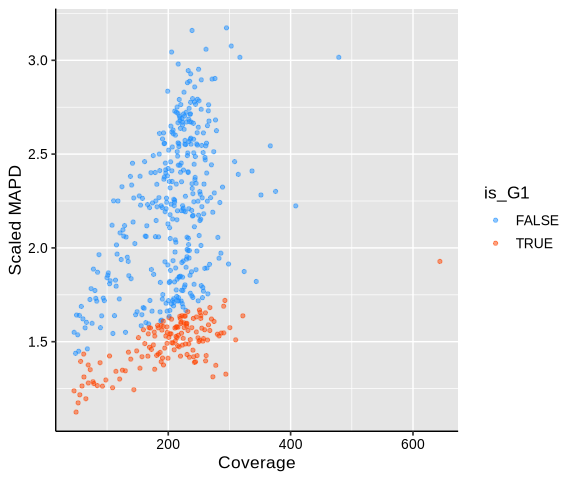
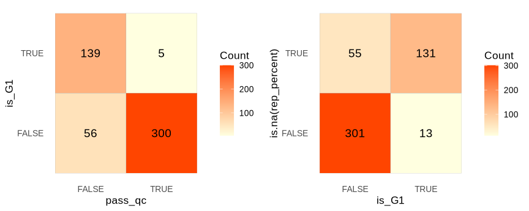
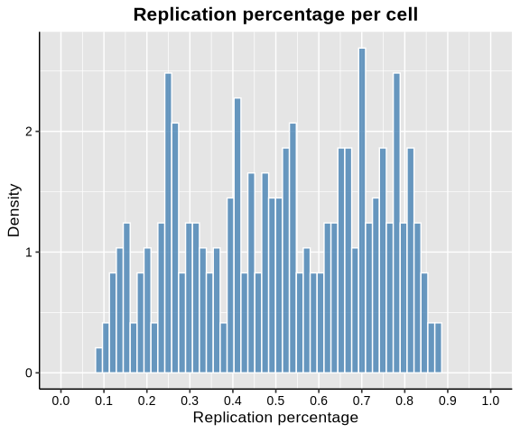
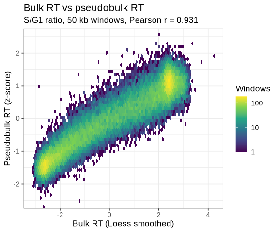
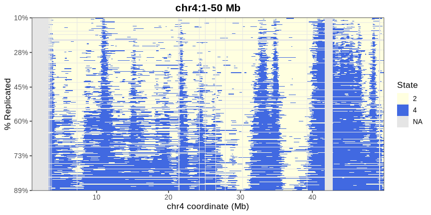
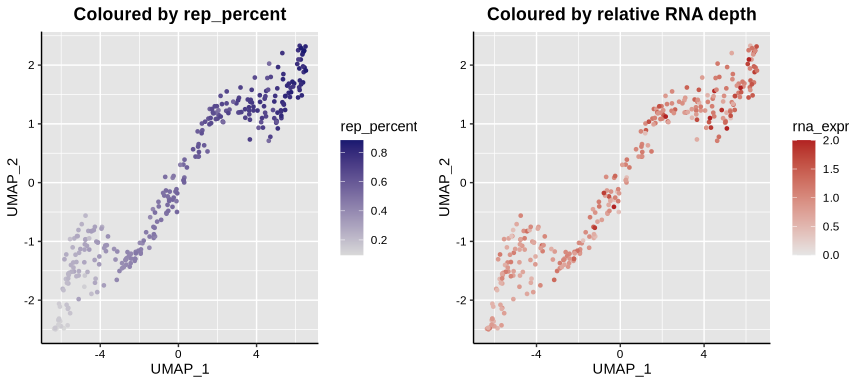
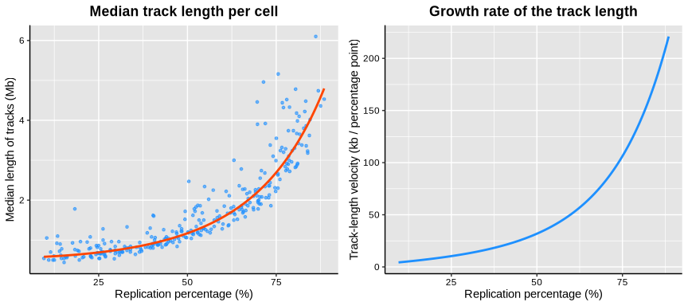
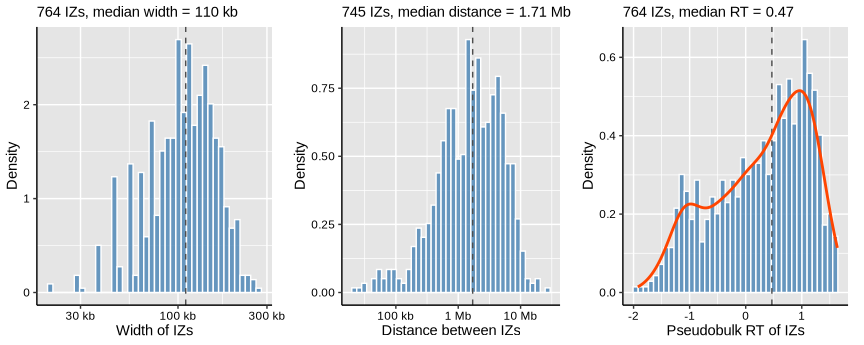
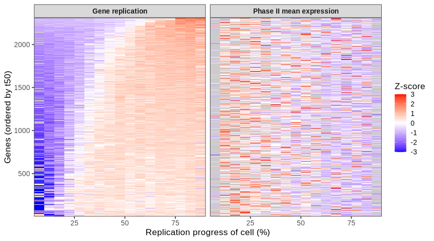

<!-- figures.Rmd is generated from this file by vignettes/precompute.R; edit
this file, not figures.Rmd. The code takes 15-35 minutes, so it is run once
locally and the knitted result (text, output and figures-*.png) is committed;
R CMD build and pkgdown only render the precomputed figures.Rmd. -->


> This vignette is precomputed: its code was run when the package sources
> were prepared, not when the package was built. Running it yourself takes
> 15-35 minutes (mostly `assign_replication_states()` on 500 cells) and needs
> ggplot2, hexbin, robustbase, irlba and uwot.

This vignette recomputes the main figures of a scRT analysis with the
package functions, from raw counts to replication tracks, initiation zones and
gene expression. It uses the larger example dataset:
`scrt_example_data("vignette")` holds genome-wide 20 kb counts of 500 cells of
the mouse ESC multiome sample `scRT1` (100 cells called G1 and 400 called
non-G1 in the original analysis, not filtered on QC), their RNA counts and a
bulk Repli-seq replication-timing track. These data (49 MB) are not installed
with the package; the first call of `scrt_example_data("vignette")` downloads
them from a GitHub release and caches them. Because it has about a tenth of the
cells of the full sample, the curves are noisier and the counts (cells,
initiation zones) are smaller than in the full analysis, but the shapes are the
same.

The package has no plotting functions; the figures are drawn with ggplot2
(plus hexbin, irlba and uwot for single plots), which the vignette needs in
addition to the package. Each step section names the package functions it
uses.

| Section | Figure | Main functions |
|---|---|---|
| 1 | MAPD vs coverage, G1 calls | `calculate_mapd()`, `find_g1_cells()` |
| 2 | QC tables | `assign_replication_states()`, `compute_rep_percent()` |
| 3 | rep_percent of S cells | `compute_rep_percent()` |
| 4 | Pseudobulk vs bulk RT | `aggregate_pseudobulk_s_g1_counts()`, `calculate_pseudobulk_rt_g1_ratio()` |
| 5 | Single-cell replication states | `compute_rep_percent()` |
| 6 | UMAP of replication states | (irlba, uwot) |
| 7 | Track length and its velocity | `define_replication_tracks()`, `summarize_track_lengths()`, `fit_track_velocity_linear()` |
| 8 | Initiation zones: width, distance, RT | `count_track_centers()`, `define_initiation_zones()` |
| 9 | Gene replication vs expression | `rep_tempo()`, `fit_rep_tempo()`, `gex_tempo()` |


``` r
library(scRTtools)
library(GenomicRanges)
library(ggplot2)

ex <- scrt_example_data("vignette")
names(ex)
#> [1] "bins"          "bin_counts"    "g1_windows"    "window_counts" "rna_counts"    "genes"        
#> [7] "bulk_rt"       "meta"          "info"
table(called_G1 = ex$meta$is_G1)
#> called_G1
#> FALSE  TRUE 
#>   400   100
```

All figures share one ggplot2 theme (grey panel, white grid):


``` r
theme_scrt <- function(base_size = 13) {
  theme_bw(base_size = base_size) +
    theme(panel.background = element_rect(fill = "grey90", colour = NA),
          panel.grid.major = element_line(colour = "white", linewidth = 0.5),
          panel.grid.minor = element_line(colour = "white", linewidth = 0.25),
          panel.border = element_blank(),
          axis.line = element_line(colour = "black", linewidth = 0.5),
          axis.text = element_text(colour = "black"),
          plot.title = element_text(hjust = 0.5, face = "bold"),
          legend.key = element_blank())
}
col_g1 <- "orangered"
col_s <- "dodgerblue"
```

## 1. Cell-cycle calls from MAPD and coverage

Replicating (S-phase) cells have a mix of one- and two-copy regions, so their
read counts vary more between neighbouring bins than those of G1 cells. The
MAPD (median absolute pairwise difference of log counts of adjacent bins)
captures this variation; it also falls with sequencing depth, so
`find_g1_cells()` scales it by coverage and calls the low-MAPD cells G1.


``` r
bin_counts <- Matrix::Matrix(ex$bin_counts, sparse = TRUE)
mapd <- calculate_mapd(bin_counts, ex$bins, ex$meta[, c("cell_id", "sample")])
g1 <- find_g1_cells(mapd, seed = 1)
table(G1 = g1$is_G1)
#> G1
#> FALSE  TRUE 
#>   356   144
```


``` r
ggplot(g1, aes(coverage, scaled_mapd, colour = is_G1)) +
  geom_point(alpha = 0.5, size = 1.2) +
  scale_colour_manual(values = c(`TRUE` = col_g1, `FALSE` = col_s), name = "is_G1") +
  labs(x = "Coverage", y = "Scaled MAPD") +
  theme_scrt()
```

<div class="figure" style="text-align: center">

<p class="caption">plot of chunk mapd-plot</p>
</div>

## 2. Replication states and QC

Replication states are inferred for every cell, G1 cells included: on
variable-width windows that hold about the same number of G1 reads, a
hidden Markov model labels each window as unreplicated (2 copies) or
replicated (4 copies). `compute_rep_percent()` then summarizes each cell
(fraction replicated, `rep_percent`) and flags cells whose chromosomes
disagree too much (`pass_qc`). This is the slowest step of the vignette.


``` r
window_counts <- Matrix::Matrix(ex$window_counts, sparse = TRUE)
res_states <- assign_replication_states(
  window_counts, ex$g1_windows, ex$bins,
  BPPARAM = BiocParallel::MulticoreParam(n_workers),
  chunk_size = ceiling(ncol(window_counts) / n_workers)  # one block of cells per worker
)
res_rp <- compute_rep_percent(res_states$genobins_rep_states, ex$bins,
                              ex$meta[, c("cell_id", "sample")])
md <- res_rp$meta_data
md$is_G1 <- g1[rownames(md), "is_G1"]
md$pass_qc <- md$pass_qc %in% TRUE
```

G1 cells should fail the replication-state QC or get no `rep_percent` at all,
and most S cells should pass:


``` r
plot_table <- function(x, y, xlab, ylab) {
  tab <- as.data.frame(table(x = x, y = y))
  ggplot(tab, aes(x, y, fill = Freq)) +
    geom_tile(colour = "grey70") +
    geom_text(aes(label = Freq), size = 5) +
    scale_fill_gradient(low = "lightyellow", high = "orangered", name = "Count") +
    labs(x = xlab, y = ylab) +
    theme_minimal(base_size = 13) +
    theme(panel.grid = element_blank())
}
p1 <- plot_table(md$pass_qc, md$is_G1, "pass_qc", "is_G1")
p2 <- plot_table(md$is_G1, is.na(md$rep_percent), "is_G1", "is.na(rep_percent)")
gridExtra_free <- function(...) {   # side by side without extra packages
  grid::grid.newpage()
  grid::pushViewport(grid::viewport(layout = grid::grid.layout(1, 2)))
  for (i in seq_along(list(...))) {
    print(list(...)[[i]], vp = grid::viewport(layout.pos.row = 1, layout.pos.col = i))
  }
}
gridExtra_free(p1, p2)
```

<div class="figure" style="text-align: center">

<p class="caption">plot of chunk qc-tables</p>
</div>

From here on, "S cells" are the cells called non-G1 that pass QC.


``` r
s_cells <- rownames(md)[!md$is_G1 & md$pass_qc & is.finite(md$rep_percent)]
length(s_cells)
#> [1] 300
states <- res_rp$genobins_rep_states_filtered[, s_cells, drop = FALSE]
md_s <- md[s_cells, , drop = FALSE]
```

## 3. Replication progress of S cells


``` r
ggplot(md_s, aes(rep_percent)) +
  geom_histogram(aes(y = after_stat(density)), bins = 50, boundary = 0,
                 fill = "steelblue", colour = "white", alpha = 0.8) +
  scale_x_continuous(breaks = seq(0, 1, 0.1)) +
  coord_cartesian(xlim = c(0, 1)) +
  labs(x = "Replication percentage", y = "Density",
       title = "Replication percentage per cell") +
  theme_scrt()
```

<div class="figure" style="text-align: center">

<p class="caption">plot of chunk rep-percent-plot</p>
</div>

## 4. Pseudobulk replication timing vs bulk Repli-seq

Pooling the reads of all S cells and dividing by the pooled G1 reads gives a
pseudobulk replication-timing profile: early-replicating regions have more
copies in S phase. It should agree with bulk Repli-seq of the same cell
type. Both tracks are averaged in 50 kb windows before comparing them.


``` r
rt_meta <- md[, c("cell_id", "sample", "is_G1", "rep_percent", "pass_qc")]
rt_counts <- aggregate_pseudobulk_s_g1_counts(bin_counts, rt_meta, names(ex$bins))
attr(rt_counts, "selected_cells")
#>   sample n_s n_g1
#> 1      1 300  144
rt <- calculate_pseudobulk_rt_g1_ratio(rt_counts, ex$bins)
```


``` r
windows <- tileGenome(seqinfo(ex$bins), tilewidth = 50000L,
                      cut.last.tile.in.chrom = TRUE)
window_mean <- function(gr) {
  gr <- gr[is.finite(gr$score)]
  hits <- findOverlaps(windows, gr)
  out <- rep(NA_real_, length(windows))
  agg <- tapply(gr$score[subjectHits(hits)], queryHits(hits), mean)
  out[as.integer(names(agg))] <- agg
  out
}
df_rt <- data.frame(bulk = window_mean(ex$bulk_rt), pseudo = window_mean(rt))
df_rt <- df_rt[stats::complete.cases(df_rt), ]
r <- cor(df_rt$bulk, df_rt$pseudo)
ggplot(df_rt, aes(bulk, pseudo)) +
  geom_hex(bins = 100) +
  scale_fill_viridis_c(trans = "log10", name = "Windows") +
  coord_cartesian(ylim = c(-2.5, 2.5)) +   # a few outlier windows lie beyond
  labs(title = "Bulk RT vs pseudobulk RT",
       subtitle = sprintf("S/G1 ratio, 50 kb windows, Pearson r = %.3f", r),
       x = "Bulk RT (Loess smoothed)", y = "Pseudobulk RT (z-score)") +
  theme_bw(base_size = 13)
```

<div class="figure" style="text-align: center">

<p class="caption">plot of chunk pseudobulk-plot</p>
</div>

## 5. Single-cell replication states

Each row is one S cell, sorted by `rep_percent`; replicated regions (4
copies, blue) widen from early- to late-replicating cells.


``` r
in_region <- which(as.character(seqnames(ex$bins)) == "chr4" &
                   start(ex$bins) >= 1e6 & end(ex$bins) <= 50e6)
cell_order <- order(md_s$rep_percent)
df_states <- data.frame(
  pos = rep(start(ex$bins)[in_region] / 1e6, times = length(cell_order)),
  cell = rep(seq_along(cell_order), each = length(in_region)),
  state = factor(as.vector(states[in_region, cell_order]), levels = c(2, 4))
)
y_breaks <- unique(round(seq(1, length(cell_order), length.out = 6)))
ggplot(df_states, aes(pos, cell, fill = state)) +
  geom_raster() +
  scale_fill_manual(values = c(`2` = "lightyellow", `4` = "royalblue"),
                    na.value = "grey90", name = "State") +
  scale_y_reverse(breaks = y_breaks, expand = c(0, 0),
                  labels = paste0(round(100 * md_s$rep_percent[cell_order][y_breaks]), "%")) +
  scale_x_continuous(expand = c(0, 0)) +
  labs(x = "chr4 coordinate (Mb)", y = "% Replicated", title = "chr4:1-50 Mb") +
  theme_bw(base_size = 13) +
  theme(plot.title = element_text(hjust = 0.5, face = "bold"))
```

<div class="figure" style="text-align: center">

<p class="caption">plot of chunk states-plot</p>
</div>

## 6. UMAP of replication states

The replication states alone order the S cells along S phase. As in the
original analysis, the binary state matrix is normalized like an ATAC matrix
(TF-IDF, log), reduced with a truncated SVD and embedded with UMAP; bins
without a call count as unreplicated.


``` r
x <- states
x[is.na(x)] <- 2
x <- Matrix::Matrix(x == 4, sparse = TRUE) * 1
x <- x[Matrix::rowSums(x) > 0, , drop = FALSE]
tfidf <- Matrix::t(Matrix::t(x) / Matrix::colSums(x)) / Matrix::rowMeans(x)
tfidf <- log1p(1e4 * tfidf)
set.seed(2026)
svd <- irlba::irlba(scale(Matrix::t(tfidf), center = TRUE, scale = FALSE), nv = 30)
pcs <- svd$u %*% diag(svd$d)
umap <- uwot::umap(pcs, n_neighbors = 15, seed = 2026)
df_umap <- data.frame(UMAP_1 = umap[, 1], UMAP_2 = umap[, 2],
                      rep_percent = md_s$rep_percent,
                      rna_expr = ex$meta[s_cells, "nCount_rna"] /
                        mean(ex$meta[s_cells, "nCount_rna"]))
```


``` r
p_rep <- ggplot(df_umap, aes(UMAP_1, UMAP_2, colour = rep_percent)) +
  geom_point(size = 1) +
  scale_colour_gradient(low = "grey85", high = "midnightblue") +
  labs(title = "Coloured by rep_percent") + theme_scrt(11)
p_rna <- ggplot(df_umap, aes(UMAP_1, UMAP_2, colour = rna_expr)) +
  geom_point(size = 1) +
  scale_colour_gradient(low = "grey90", high = "firebrick", limits = c(0, 2),
                        oob = scales::squish) +
  labs(title = "Coloured by relative RNA depth") + theme_scrt(11)
gridExtra_free(p_rep, p_rna)
```

<div class="figure" style="text-align: center">

<p class="caption">plot of chunk umap-plot</p>
</div>

The RNA depth of a cell (its RNA counts over the mean of the S cells) rises
along the same trajectory: cells late in S phase have more RNA.

## 7. Replication track length and its velocity

A replication track is a run of replicated bins in one cell. Tracks grow as
forks move outwards from initiation zones, so the median track length of a
cell increases with its replication progress, slowly in early S and fast
when neighbouring tracks merge in late S. `fit_track_velocity_linear()` fits
`log(length) ~ rep_percent + rep_percent^2` robustly and derives the growth
rate ("velocity") of the track length per percentage point.


``` r
tracks <- define_replication_tracks(states, ex$bins,
                                    setNames(md_s$rep_percent, s_cells))
track_lengths <- calc_rep_track_lengths(tracks)
median_lengths <- summarize_track_lengths(track_lengths)
head(median_lengths, 3)
#>                    cell_id median_length log_length rep_percent
#> 1 scRT1-AAAGCACCAACATAAG-1       4740000      15.37       86.86
#> 2 scRT1-AAAGCCGCAAACGGGC-1       1360000      14.12       61.49
#> 3 scRT1-AAAGGACGTCACCTAT-1        600000      13.30       16.16
velocity <- fit_track_velocity_linear(median_lengths, n_grid = 200, fit_seed = 1)
velocity$validation_metrics
#>     rmse pseudo_r2 correlation
#> 1 0.2089    0.8774      0.9389
```


``` r
p_len <- ggplot(median_lengths, aes(rep_percent, median_length / 1e6)) +
  geom_point(colour = col_s, alpha = 0.6, size = 1) +
  geom_line(data = velocity$prediction, aes(rep_percent, lmrob_length / 1e6),
            colour = col_g1, linewidth = 1) +
  labs(x = "Replication percentage (%)", y = "Median length of tracks (Mb)",
       title = "Median track length per cell") + theme_scrt(11)
p_vel <- ggplot(velocity$prediction, aes(rep_percent, length_velocity / 1e3)) +
  geom_line(colour = col_s, linewidth = 1) +
  labs(x = "Replication percentage (%)",
       y = "Track-length velocity (kb / percentage point)",
       title = "Growth rate of the track length") + theme_scrt(11)
gridExtra_free(p_len, p_vel)
```

<div class="figure" style="text-align: center">

<p class="caption">plot of chunk tracks-plot</p>
</div>

## 8. Initiation zones

Short tracks are centred on the initiation zones (IZs) that fired them. The
centres of short, gap-free tracks are counted per bin; bins hit by several
cells seed the IZs, and `define_initiation_zones()` then clusters the tracks
of all cells around these seeds. An IZ must be supported by tracks of at
least `min_usage` cells.


``` r
centers <- count_track_centers(tracks, ex$bins,
                               track_filter = (num_bins <= 50) & (flag == 0))
table(pmin(centers$score, 5))
#> 
#>     0     1     2     3     4     5 
#> 97190 15323  5084  2366  1274  1911
seeds <- centers[centers$score >= 3]
res_iz <- define_initiation_zones(
  tracks, seeds, max_track_length = "1Mb", min_usage = 3L, bin_size = "20Kb",
  BPPARAM = BiocParallel::MulticoreParam(n_workers)
)
iz <- res_iz$izones
length(iz)
#> [1] 764
```

For each IZ we report its width, the distance to the next IZ on the same
chromosome, and its replication timing (the mean pseudobulk RT of section 4
over the IZ). With about 300 S cells only the more frequently used IZs reach
`min_usage`, so there are fewer IZs than in the full sample and the distance
between neighbouring IZs is larger; widths and timing are comparable.


``` r
next_start <- c(start(iz)[-1], NA)
same_chr <- c(as.character(seqnames(iz))[-1] == as.character(seqnames(iz))[-length(iz)], FALSE)
iz_distance <- (next_start - end(iz) - 1)[same_chr]
hits <- findOverlaps(iz, rt[is.finite(rt$score)])
iz$rt <- NA_real_
agg <- tapply(rt[is.finite(rt$score)]$score[subjectHits(hits)], queryHits(hits), mean)
iz$rt[as.integer(names(agg))] <- agg
summary(width(iz))
#>    Min. 1st Qu.  Median    Mean 3rd Qu.    Max. 
#>   20000   81000  110000  113502  141000  262500
```


``` r
iz_hist <- function(df, x, label, xlab, log_x = TRUE, density = FALSE) {
  med <- stats::median(df[[x]], na.rm = TRUE)
  p <- ggplot(df, aes(.data[[x]])) +
    geom_histogram(aes(y = after_stat(density)), bins = 40, boundary = 0,
                   fill = "steelblue", colour = "white", alpha = 0.8) +
    geom_vline(xintercept = med, linetype = "dashed", colour = "grey30") +
    labs(x = xlab, y = "Density",
         subtitle = paste0(nrow(df), " IZs, median ", label, " = ",
                           if (log_x) format_bp(med) else round(med, 2))) +
    theme_scrt(11) + theme(plot.margin = margin(5, 12, 5, 5))
  if (density) p <- p + geom_density(colour = col_g1, linewidth = 1)
  if (log_x) p <- p + scale_x_log10(labels = format_bp)
  p
}
p_w <- iz_hist(data.frame(width = width(iz)), "width", "width", "Width of IZs")
p_d <- iz_hist(data.frame(distance = iz_distance[iz_distance > 0]), "distance",
               "distance", "Distance between IZs")
p_rt <- iz_hist(data.frame(rt = iz$rt[is.finite(iz$rt)]), "rt", "RT",
                "Pseudobulk RT of IZs", log_x = FALSE, density = TRUE)
grid::grid.newpage()
grid::pushViewport(grid::viewport(layout = grid::grid.layout(1, 3)))
for (i in 1:3) print(list(p_w, p_d, p_rt)[[i]],
                     vp = grid::viewport(layout.pos.row = 1, layout.pos.col = i))
```

<div class="figure" style="text-align: center">

<p class="caption">plot of chunk iz-plot</p>
</div>

## 9. Gene replication vs gene expression

For every gene, the S cells are split into bins of replication progress and
`rep_tempo()` reports the fraction of cells of each bin in which the gene is
replicated. `fit_rep_tempo()` fits a logistic curve per gene; its `t50`
(the progress at which half of the cells have replicated the gene) orders
the genes from early to late replicating.


``` r
genes <- ex$genes
rna <- ex$rna_counts[, s_cells]
genes <- genes[genes$gene %in% rownames(rna)[Matrix::rowSums(rna > 0) >= 20], ]
gene_gr <- GRanges(genes$chr, IRanges(genes$start, genes$end), gene = genes$gene)
names(gene_gr) <- genes$gene
nbin <- 20L
gene_tempo <- rep_tempo(states, gene_gr, meta_data = md_s, nbin_rep = nbin)
gene_fit <- fit_rep_tempo(gene_tempo, model_type = "sslogis",
                          BPPARAM = BiocParallel::MulticoreParam(n_workers))
table(gene_fit$fit_status)
#> 
#>      curve_qc_flag         fit_failed            no_data                 ok partial_thresholds 
#>                459                458                483               1238               1241
```

`gex_tempo()` bins the same cells in the same way and summarizes the
expression of each gene per bin; with `method = "sc2p"` it separates the
fraction of cells expressing the gene (phase I) from the mean expression in
the expressing cells (phase II).


``` r
gex <- suppressWarnings(gex_tempo(as.matrix(rna[genes$gene, ]), md_s,
                                  nbin_rep = nbin, method = "sc2p"))
names(gex)
#> [1] "df_phase_I"  "df_phase_II"
```

Both heatmaps use the same gene order (by `t50`, earliest at the bottom) and
z-scores per gene. Replication (left) moves as a front through S phase,
whereas expression (right) has no such front.


``` r
rep_bins <- attr(gene_tempo, "rep_bins")   # progress bins, in % (0-100)
filled <- rep_bins$n_cells > 0
# genes whose logistic fit passed QC; "partial_thresholds" only misses t10/t90
ok <- gene_fit$fit_status %in% c("ok", "partial_thresholds") & is.finite(gene_fit$t50)
gene_order <- gene_fit$region_id[ok][order(gene_fit$t50[ok])]
gene_order <- gene_order[gene_order %in% rownames(gex$df_phase_II)]
heat_long <- function(mat, title) {
  mat <- as.matrix(mat[gene_order, filled, drop = FALSE])
  z <- t(apply(mat, 1, zscore_safe))
  data.frame(progress = rep((rep_bins$rep_min + rep_bins$rep_max)[filled] / 2,
                            each = nrow(z)),
             gene = rep(seq_len(nrow(z)), times = ncol(z)),  # earliest t50 at the bottom
             z = as.vector(z), panel = title)
}
df_heat <- rbind(heat_long(gene_tempo, "Gene replication"),
                 heat_long(gex$df_phase_II, "Phase II mean expression"))
bin_width <- (rep_bins$rep_max - rep_bins$rep_min)[1]
ggplot(df_heat, aes(progress, gene, fill = z)) +
  geom_tile(width = bin_width, height = 1) +
  facet_wrap(~panel) +
  scale_fill_gradient2(low = "blue", mid = "white", high = "red", limits = c(-3, 3),
                       oob = scales::squish, na.value = "grey80", name = "Z-score") +
  scale_x_continuous(expand = c(0, 0)) + scale_y_continuous(expand = c(0, 0)) +
  labs(x = "Replication progress of cell (%)", y = "Genes (ordered by t50)") +
  theme_bw(base_size = 13) +
  theme(strip.text = element_text(face = "bold"))
```

<div class="figure" style="text-align: center">

<p class="caption">plot of chunk gene-heatmap</p>
</div>

## Session


``` r
sessionInfo()
#> R version 4.3.3 (2024-02-29)
#> Platform: x86_64-conda-linux-gnu (64-bit)
#> Running under: CentOS Linux 7 (Core)
#> 
#> Matrix products: default
#> BLAS/LAPACK: /data/hjji/miniconda3/envs/new_sc_envs/lib/libopenblasp-r0.3.27.so;  LAPACK version 3.12.0
#> 
#> locale:
#>  [1] LC_CTYPE=en_US.UTF-8       LC_NUMERIC=C               LC_TIME=en_US.UTF-8       
#>  [4] LC_COLLATE=en_US.UTF-8     LC_MONETARY=en_US.UTF-8    LC_MESSAGES=en_US.UTF-8   
#>  [7] LC_PAPER=en_US.UTF-8       LC_NAME=C                  LC_ADDRESS=C              
#> [10] LC_TELEPHONE=C             LC_MEASUREMENT=en_US.UTF-8 LC_IDENTIFICATION=C       
#> 
#> time zone: Asia/Shanghai
#> tzcode source: system (glibc)
#> 
#> attached base packages:
#> [1] stats4    stats     graphics  grDevices utils     datasets  methods   base     
#> 
#> other attached packages:
#> [1] ggplot2_3.5.1        GenomicRanges_1.54.1 GenomeInfoDb_1.38.1  IRanges_2.36.0      
#> [5] S4Vectors_0.40.2     BiocGenerics_0.48.1  scRTtools_0.0.0.9001
#> 
#> loaded via a namespace (and not attached):
#>  [1] utf8_1.2.4              generics_0.1.3          robustbase_0.99-4       bitops_1.0-7           
#>  [5] lattice_0.22-6          magrittr_2.0.3          evaluate_0.24.0         grid_4.3.3             
#>  [9] Matrix_1.6-5            survival_3.7-0          fansi_1.0.6             viridisLite_0.4.2      
#> [13] scales_1.3.0            codetools_0.2-20        cli_3.6.3               rlang_1.1.4            
#> [17] XVector_0.42.0          uwot_0.1.16             splines_4.3.3           munsell_0.5.1          
#> [21] withr_3.0.1             FNN_1.1.4               tools_4.3.3             parallel_4.3.3         
#> [25] MatrixModels_0.5-3      SparseM_1.83            BiocParallel_1.36.0     dplyr_1.1.4            
#> [29] colorspace_2.1-1        GenomeInfoDbData_1.2.11 vctrs_0.6.5             R6_2.5.1               
#> [33] lifecycle_1.0.4         zlibbioc_1.48.0         MASS_7.3-60             irlba_2.3.5.1          
#> [37] pkgconfig_2.0.3         pillar_1.9.0            hexbin_1.28.3           gtable_0.3.5           
#> [41] glue_1.7.0              Rcpp_1.0.13             DEoptimR_1.1-4          xfun_0.44              
#> [45] tibble_3.2.1            tidyselect_1.2.1        highr_0.11              knitr_1.48             
#> [49] farver_2.1.2            labeling_0.4.3          compiler_4.3.3          quantreg_5.98          
#> [53] RCurl_1.98-1.14
```
